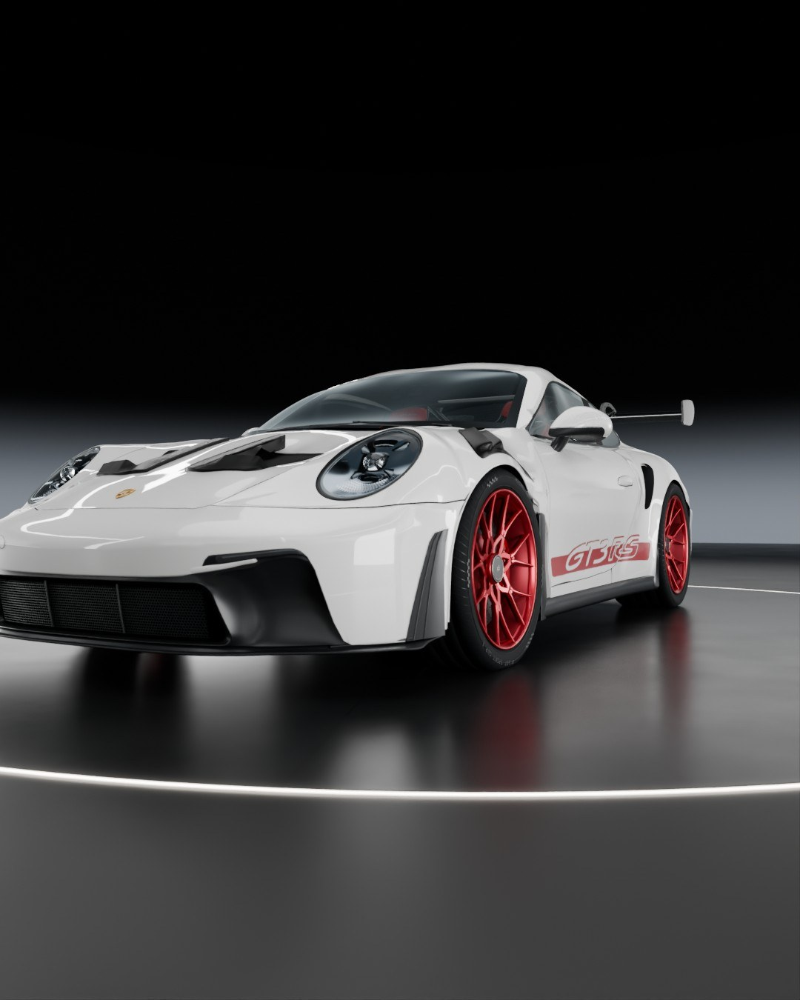

# replica-garage

An agent skill for building an exact real vehicle in Blender from photos, blueprints and the maker's
dimensions.

It is written for an AI coding agent that can read files and run Blender. The agent acts as a manager: it
finds the references, solves a camera for each photo, directs a small team of builder agents, runs a fresh
judge against the photos each round, and stops to ask you at four fixed points. An agent that cannot start
sub-agents can follow the same steps alone.

The car above is the build this skill was written from. See [the worked example](examples/gt3rs/README.md)
for more pictures, the film, and what it took.

## What you get

A finished model: shape, paint, glass, lamps and interior, built entirely from code, with every colour as a
switch. If you ask for it, the vehicle comes apart: panels and wheels, or a full teardown to the bare shell.

## What it costs

Be ready for days of agent time. The build this skill came from, a Porsche 911 GT3 RS, took:

| | Agent hours | Cost at API prices |
|---|---|---|
| First finished car | 41.6 | $592 |
| With the fixes that followed | 74.3 | $1,073 |

Those figures are for the builder agents only and leave out the manager's own usage and render time.

## How it works

1. **References.** The agent finds free photos, drawings and the maker's dimensions, and shows you the set.
2. **Cameras.** It solves where each photo was taken from, so every later comparison is a render through that
   photo's own camera, set beside the photo.
3. **Look card.** It asks you for colours, finishes, plates, and how far the vehicle should come apart.
4. **First build.** Builders each write one assembly as code, the manager assembles them into one vehicle,
   and you see the whole thing early.
5. **Judge loop.** A fresh judge marks faults on pictures. Builders fix one marked area each. This runs as a
   baseline and up to three fix rounds before each time you are shown the vehicle.
6. **Your eye.** You see the measured gates, what still fails, and the close-ups, and you sign off or mark
   more.

## Install

Copy or clone this folder into your agent's skills folder, then ask it to build a vehicle:

> Use replica-garage to build a 1974 Lamborghini Countach LP400.

You need Blender and Python 3.10 or newer. `tools/requirements.txt` lists the Python packages.

## Honest limits

- **It comes from one build.** The method and the gate limits were worked out on a single car. Trucks, bikes
  and other vehicles are untried.
- **The tools are new.** They pass their tests on small made-up scenes, and one small render has been through
  a graphics card. They have not yet been through a whole build of a real vehicle.
- **It measures; it does not trace.** The build it came from used hand-traced drawings as well. This skill
  works from blueprints and photos through solved cameras only, and that route is still being proven.
- **Reference material stays with you.** The agent finds it from free sources and keeps it on your machine.
  Nothing a maker published is included here, and you should not publish it either.
- **A real vehicle carries real badges.** What you may do with a model of someone else's design is for you to
  check.

## What is in here

| | |
|---|---|
| `SKILL.md` | The manager's steps |
| `BRIEFS.md` | What each builder and judge is told, and the fix note format |
| `BLENDER.md` | Best practice for modelling, paint, light and rendering |
| `vehicles/` | Short notes on specific vehicles already built; add yours |
| `REFERENCES.md` | Finding references and solving cameras |
| `TAKE-APART.md` | The three take-apart levels |
| `SOLO.md` | Following the skill without sub-agents |
| `tools/` | Camera solving, comparison boards, close-ups, gates and the rest; see `tools/CONTRACT.md` |

## Licence

MIT. See [LICENSE](LICENSE).
