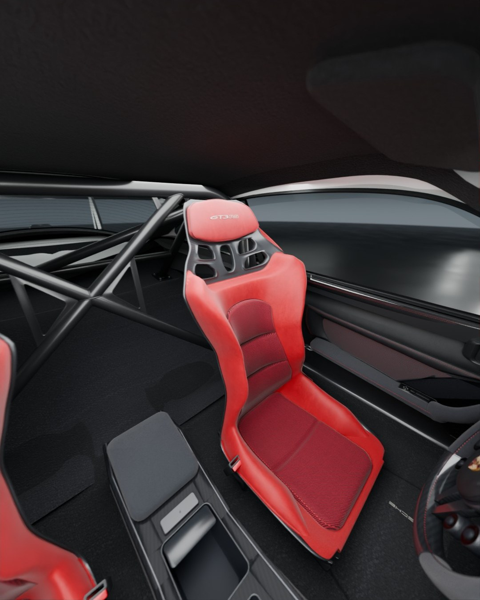
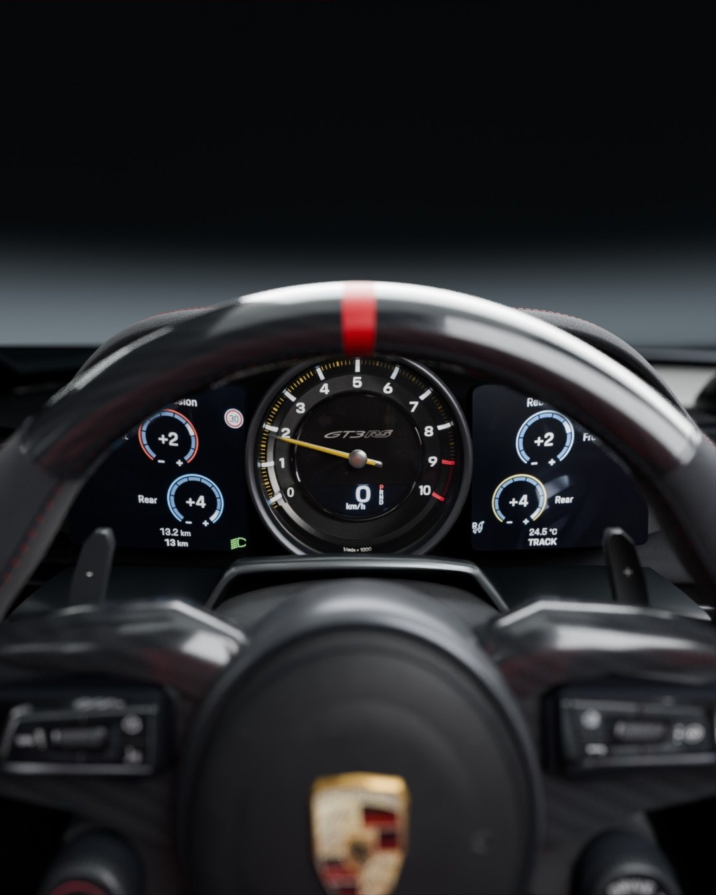
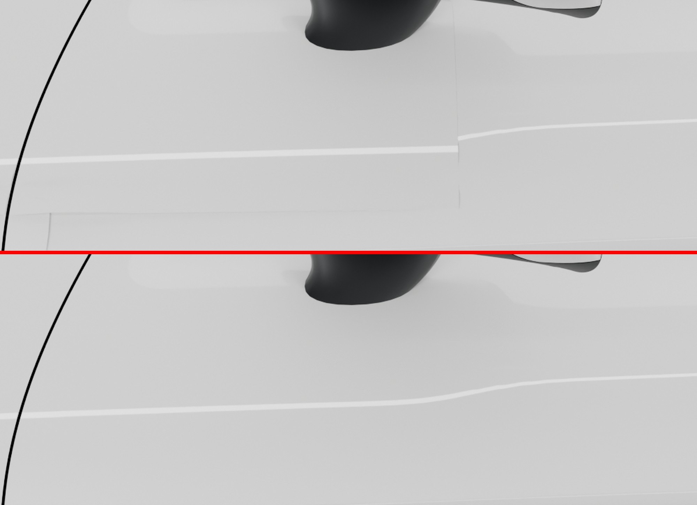
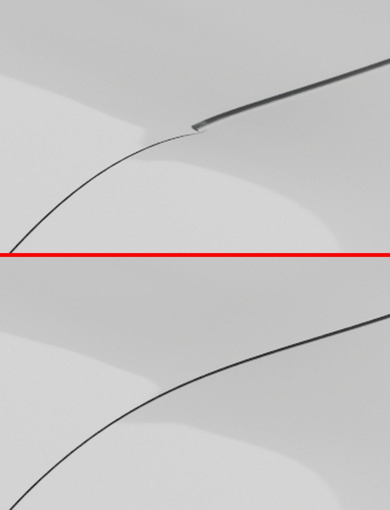

# Worked example: Porsche 911 GT3 RS (992)

The build this skill was written from. Everything here is our own render of our own model; none of the
maker's photos or drawings are included.

| | |
|---|---|
|  |  |
|  |  |
|  |  |

These pictures are stills from a 20 second film of the finished car; [film-sheet.jpg](film-sheet.jpg) shows
stills from the whole of it.

## What it took

| | Agent hours | Cost at API prices |
|---|---|---|
| First finished car | 41.6 | $592.49 |
| The fixes that followed | 32.7 | $480.38 |
| Total | 74.3 | $1,072.87 |

The first build ran as a lead agent with eight sub-agents and two overnight threads; the fixes were five
agents working one marked area each under a manager. The builders were GPT-6.2-Astra at its highest reasoning
effort and the manager was Claude. Agent hours add up the time each agent was working, so agents running side
by side count separately; on the clock it was about 38 hours. The figures leave out the manager's own usage,
the film and render time.

## What the judge loop did

An independent judge scored the body after every round overnight and gave targeted fixes. The score went from
62 to 93 out of 100 in thirteen rounds. One round went backwards, from 83 to 75, when a fix opened gaps in a
panel; the next round caught it.

A score of 93 still sat beside joins a person would call wrong. That is why this skill treats a score as a
trend only, and clears a fault when its own picture shows it gone.

## What close-ups found

Ten views from all round the car looked finished. Close-ups about 0.6 m across then showed a hooked trim
edge, a seal that was too thick and a stepped notch on a door. Two of the fixes, before above and after below:

The first pair is the reason for the one-skin rule: the repair looked right from the front, and its outline
showed from the side. The second is the reason for the fair-curve rule.

## How this build differs from the skill

- It used hand-traced drawings as well as photos. The skill measures from photos and drawings through solved
  cameras and does no tracing.
- Its judging was by score first, with the hard gates added later. The skill starts with the gates.
- The take-apart version was built afterwards as a separate workshop copy, which is how the skill does level 3.
